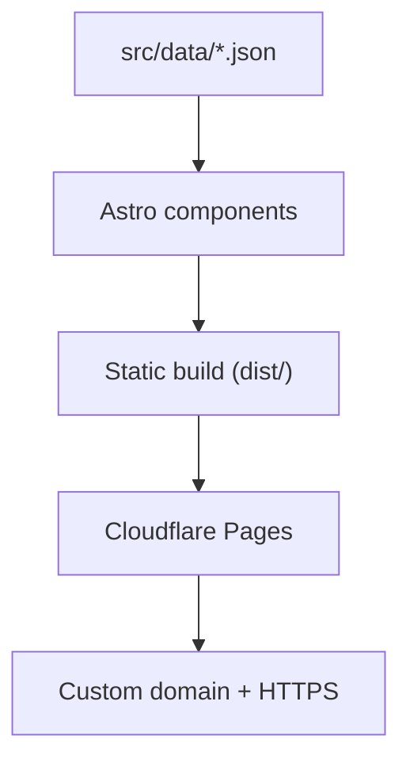

# eyepsy — психологическая помощь (static rebuild)

A fully static rebuild of **https://www.eyepsy.ru/** — a psychology practice site
(Санкт-Петербург + онлайн) with two clinical psychologists —
designed for free hosting on **Cloudflare Pages**.

The original site was a Bitrix24.Sites landing page. This project replaces it with
clean, semantic, framework-built static HTML and contains **no Bitrix code, scripts,
styles, or dependencies**.

## Tech stack

| Concern    | Choice                                            |
| ---------- | ------------------------------------------------- |
| Framework  | [Astro](https://astro.build) (static output)      |
| Styling    | Tailwind CSS v4 (`@tailwindcss/vite`)             |
| Content    | JSON data files + Astro components                |
| Images     | WebP (generated with `sharp`)                     |
| Sitemap    | `@astrojs/sitemap`                                |
| Hosting    | Cloudflare Pages (static, free tier)              |

## Site structure



| URL            | Source                        | Content                                                        |
| -------------- | ----------------------------- | -------------------------------------------------------------- |
| `/`            | `src/pages/index.astro`       | Hero, two psychologist cards, «С чем мы работаем», contacts     |
| `/ulyana/`     | `src/pages/ulyana/index.astro`| Ульяна Рязанова — intro, pricing, diagnostics, education, certs |
| `/anastasiya/` | `src/pages/anastasiya/index.astro` | Анастасия Копылова — intro, pricing, education, certs      |

## Project layout

```
src/
├── assets/images/     Source images — hero/, team/, certificates/{ulyana,anastasiya}/,
│                      ulyana/, logo/ (optimised at build time by Astro's <Image>)
├── components/        Header, Footer, PersonCard, TopicCard, ContactList,
│                      Certificates (gallery + lightbox), Profile, Section
├── data/              All editable content (JSON) — see below
│   ├── site.json      Site title, contacts, nav, hero
│   ├── topics.json    «С чем мы работаем» cards
│   ├── people/        ulyana.json, anastasiya.json
│   └── certificates/  ulyana.json, anastasiya.json
├── layouts/           BaseLayout.astro (head/SEO, header, footer, lightbox)
├── lib/               content.ts (typed JSON access) · images.ts (asset lookup)
├── pages/             index, ulyana/, anastasiya/
└── styles/global.css  Design tokens (colors, fonts) + base styles
public/
├── favicon.ico, favicon-16x16.png, favicon-32x32.png, favicon-96x96.png,
│   apple-touch-icon.png
├── robots.txt
└── _redirects         Legacy Bitrix URL redirects for Cloudflare Pages
```

## Editing content (no code required)

All copy and lists live in JSON, so day-to-day edits never touch components.

### Add a certificate

Use the helper script — it converts the image to WebP (max 1920px), stores it, and
appends the data entry for you:

```bash
npm run cert -- ulyana ~/Downloads/scan.jpg "Схема-терапия"
```

It writes the WebP to `src/assets/images/certificates/ulyana/` (or `anastasiya/`)
and appends to `src/data/certificates/<person>.json`. The gallery then renders
automatically, in file order, and the lightbox shows the full-size image.

Manual alternative: drop a WebP into `src/assets/images/certificates/<person>/`
and add an entry to `src/data/certificates/<person>.json`:

```json
{ "src": "/images/certificates/ulyana/my-new-cert.webp", "title": "Название документа" }
```

`title` is optional and is shown as a caption.

> Images live under `src/assets/images/` but are referenced by `/images/…` paths —
> [`src/lib/images.ts`](src/lib/images.ts) maps the two, and Astro's `<Image>`
> component optimises them (resize + WebP + responsive output) at build time.

### Edit text, contacts or prices

- Phone numbers, Telegram/WhatsApp links: `src/data/site.json`
  (and per-person in `src/data/people/*.json`).
- Topics list: `src/data/topics.json`.
- Bio, pricing, education lists: `src/data/people/<slug>.json`.

## Local development

Requires Node.js 22+.

```bash
npm install
npm run dev      # local dev server (http://localhost:4321)
npm run build    # static build into dist/
npm run preview  # preview the built site
```

## Deploy to Cloudflare Pages

The project builds to a fully static `dist/` and needs no server runtime.

### Option A — Git integration (recommended)

1. Push this repository to GitHub (or GitLab).
2. In the Cloudflare dashboard: **Workers & Pages → Create → Pages → Connect to Git**.
3. Use these build settings:

   | Setting                | Value               |
   | ---------------------- | ------------------- |
   | Framework preset       | Astro               |
   | Build command          | `npm run build`     |
   | Build output directory | `dist`              |
   | Node version           | `22` (see `.nvmrc`) |

   If the preset does not read `.nvmrc`, add an environment variable
   **`NODE_VERSION = 22`** (Settings → Environment variables).

4. Deploy. Cloudflare builds and serves `dist/` on its global CDN over HTTPS.
5. Add the custom domain (`www.eyepsy.ru`) under **Custom domains** and point DNS
   (the apex/`www` currently serve the old Bitrix site — switch them over).

### Option B — Direct upload with Wrangler

```bash
npm install
npm run build
npx wrangler pages deploy dist --project-name eyepsy
```

The first run logs you in and creates the Pages project.

### Deployment notes

- `public/_redirects` is copied into `dist/` and Cloudflare applies it
  automatically — keep it (it redirects legacy Bitrix paths).
- `trailingSlash: 'always'` + `build.format: 'directory'` produce `/ulyana/` and
  `/anastasiya/`, matching the original URLs.
- Image optimisation runs at build time via `sharp`, which is available in
  Cloudflare's build image — no extra setup needed.

### Legacy URLs

Old Bitrix paths (`/bitrix/*`, `/index.php`, `/upload/*`, `/pub/site/*`, …) are
redirected to `/` via [`public/_redirects`](public/_redirects), so bookmarks and
search-engine results keep working. `/ulyana/` and `/anastasiya/` keep their
original paths.

## Notes

- Fonts (Montserrat, Open Sans) load from Google Fonts — no Bitrix font CDN.
- SEO: canonical URLs, Open Graph/Twitter tags, JSON-LD (`WebSite` + `Person`),
  `robots.txt`, and an auto-generated `sitemap-index.xml`.
- The original `_capture/` folder contains the raw mirror used for migration and
  is git-ignored.
