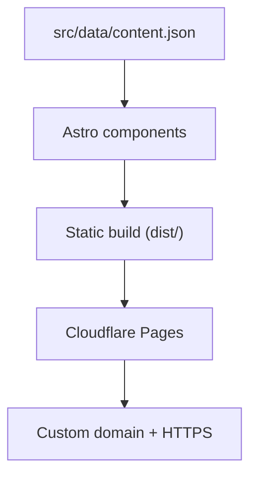

# ulianapsy — Ульяна Рязанова, клинический психолог (static rebuild)

A fully static rebuild of **https://ulianapsy.com/** — the personal page of
clinical psychologist **Ульяна Рязанова** (Санкт-Петербург + онлайн) —
designed for free hosting on **Cloudflare Pages**.

The original site was a Bitrix24.Sites landing page. This project replaces it with
clean, semantic, framework-built static HTML and contains **no Bitrix code, scripts,
styles, or dependencies**.

## Tech stack

| Concern    | Choice                                            |
| ---------- | ------------------------------------------------- |
| Framework  | [Astro](https://astro.build) (static output)      |
| Styling    | Tailwind CSS v4 (`@tailwindcss/vite`)             |
| Content    | JSON (`src/data/content.json`) + Astro components |
| Images     | WebP (generated with `sharp`)                     |
| Sitemap    | `@astrojs/sitemap`                                |
| Hosting    | Cloudflare Pages (static, free tier)              |

## Site structure



| URL | Source                  | Content                                                                 |
| --- | ----------------------- | ----------------------------------------------------------------------- |
| `/` | `src/pages/index.astro` | Hero, «С чем работаю», pricing, diagnostics, education, certs, contacts |

## Project layout

```
src/
├── assets/images/     Source images — hero/, team/, certificates/ulyana/,
│                      ulyana/, logo/ (optimised at build time by Astro's <Image>)
├── components/        Header, Footer, TopicCard, Certificates (gallery + lightbox),
│                      Profile
├── data/              All editable content
│   └── content.json   Site copy, UI labels, person, topics, certificates
├── layouts/           BaseLayout.astro (head/SEO, header, footer, lightbox)
├── lib/               content.ts (typed JSON access) · images.ts (asset lookup)
├── pages/             index
└── styles/global.css  Design tokens (colors, fonts) + base styles
public/
├── favicon.ico, favicon-16x16.png, favicon-32x32.png, favicon-96x96.png,
│   apple-touch-icon.png
├── robots.txt
└── _redirects         Legacy Bitrix URL redirects for Cloudflare Pages
admin/                 Authenticated content admin service (separate Node app)
```

## Editing content (no code required)

All copy and lists live in one file, `src/data/content.json`, so day-to-day edits
never touch components. The file has five top-level sections:

| Section        | Contains                                                                 |
| -------------- | ------------------------------------------------------------------------ |
| `site`         | Page title, SEO metadata, brand, logo, nav, hero image, CTA, footer text |
| `ui`           | Accessibility labels and shared UI strings                               |
| `person`       | Bio, contacts, pricing, education, appointment steps, FAQ                |
| `topics`       | «С чем работаю» cards                                                     |
| `certificates` | Gallery labels and the `items` list                                      |

### Add a certificate

Use the helper script — it converts the image to WebP (max 1920px), stores it, and
appends the data entry for you:

```bash
npm run cert -- ulyana ~/Downloads/scan.jpg "Схема-терапия"
```

It writes the WebP to `src/assets/images/certificates/ulyana/` and appends to
`certificates.items` in `src/data/content.json`. The gallery then renders
automatically, in file order, and the lightbox shows the full-size image.

Manual alternative: drop a WebP into `src/assets/images/certificates/ulyana/`
and add an entry to `certificates.items` in `src/data/content.json`:

```json
{ "src": "/images/certificates/ulyana/my-new-cert.webp", "title": "Название документа" }
```

`title` is optional and is shown as a caption; if omitted, the gallery uses
`certificates.fallbackTitle`.

> Images live under `src/assets/images/` but are referenced by `/images/…` paths —
> [`src/lib/images.ts`](src/lib/images.ts) maps the two, and Astro's `<Image>`
> component optimises them (resize + WebP + responsive output) at build time.

### Edit text, contacts or prices

- Phone number, Telegram/WhatsApp links: `site`/`person` in `src/data/content.json`.
- Site title, description, keywords, logo, nav, CTA and footer: `site`.
- Shared labels and accessibility text: `ui`.
- Topics list: `topics`.
- Bio, pricing, education, appointment steps, FAQ: `person`.

## Content admin service

A separate authenticated admin service lives in [`admin/`](admin/README.md). It
provides one page with two forms: add a certificate and edit
[`src/data/content.json`](src/data/content.json:1). All validation and build
checks run on the server before the change is committed and pushed with a deploy
key.

```bash
npm run admin:install
npm run admin:dev
```

See [`admin/README.md`](admin/README.md) for environment variables, deploy-key
setup, systemd, and Nginx Proxy Manager configuration.

## Local development

Requires Node.js 22+.

```bash
npm install
npm run dev      # local dev server (http://localhost:4321)
npm run build    # static build into dist/
npm run preview  # preview the built site
```

## Deploy to Cloudflare Workers & Pages

The project builds to a fully static `dist/` and needs no server runtime.

### Option A — Git integration (recommended)

1. Push this repository to GitHub (or GitLab).
2. In the Cloudflare dashboard: **Workers & Pages → Create → Connect to Git**.
3. Use these build settings:

   | Setting                | Value               |
   | ---------------------- | ------------------- |
   | Framework preset       | Astro               |
   | Build command          | `npm run build`     |
   | Build output directory | `dist`              |
   | Node version           | `22` (see `.nvmrc`) |

   If the preset does not read `.nvmrc`, add an environment variable
   **`NODE_VERSION = 22`** (Settings → Environment variables).

4. Deploy. Cloudflare builds and serves `dist/` on its global CDN over HTTPS.
5. Add the custom domain (`ulianapsy.com`) under **Custom domains** and point DNS
   (the apex/`www` currently serve the old Bitrix site — switch them over).

### Option B — Direct upload with Wrangler

```bash
npm install
npm run build
npx wrangler deploy
```

[`wrangler.toml`](wrangler.toml) configures the Worker to serve `dist/` as static
assets. The first run logs you in and creates the Worker project.

### Deployment notes

- The project deploys as a Cloudflare Worker with static assets.
  [`wrangler.toml`](wrangler.toml) points Wrangler at `dist/` and prevents the
  Astro adapter auto-config from running during CI.
- Astro requires Node `>=22.23.4`; [`.node-version`](.node-version) and the
  `engines` field in [`package.json`](package.json) pin it for Cloudflare builds.
- `public/_redirects` is copied into `dist/` and Cloudflare applies it
  automatically — keep it (it redirects legacy Bitrix paths).
- `trailingSlash: 'always'` + `build.format: 'directory'` keep the original
  trailing-slash URL shape.
- Image optimisation runs at build time via `sharp`, which is available in
  Cloudflare's build image — no extra setup needed.

### Legacy URLs

Old Bitrix paths (`/bitrix/*`, `/index.php`, `/upload/*`, `/pub/site/*`, …) are
redirected to `/` via [`public/_redirects`](public/_redirects), so bookmarks and
search-engine results keep working. The former profile URLs `/ulyana/` and
`/anastasiya/` also redirect to `/` with a `301`.

## Notes

- Fonts (Montserrat, Open Sans) load from Google Fonts — no Bitrix font CDN.
- SEO: canonical URLs, Open Graph/Twitter tags, JSON-LD (`WebSite`, `Person`,
  `FAQPage`), `robots.txt`, and an auto-generated `sitemap-index.xml`.
- The original `_capture/` folder contains the raw mirror used for migration and
  is git-ignored.
